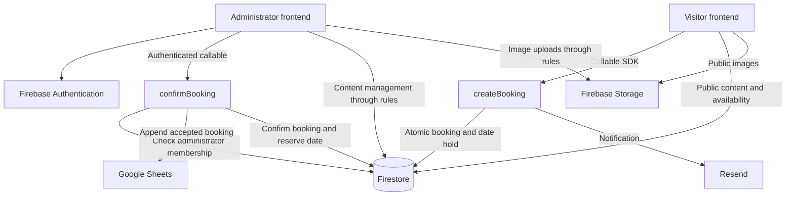

# Lumière Lens Backend

Firebase backend for a photography portfolio and booking system, featuring booking management, administrator access controls, email notifications, and Google Sheets integration.

This repository is a source snapshot for technical review. The frontend is maintained separately. Credentials, customer records, account identifiers, deployment bindings, and uploaded media are excluded.

## Technology

- JavaScript ES modules on Node.js 22
- Firebase Cloud Functions v2 callable functions
- Cloud Firestore for bookings, availability, and portfolio content
- Firebase Authentication for administrator identity
- Firebase Storage for portfolio images
- Resend API for booking notifications
- Google Sheets API with Application Default Credentials for confirmation exports

## Architecture



Functions use the Admin SDK, which bypasses client security rules. Administrator authorization is checked inside `confirmBooking`. Client content management and uploads use the Firestore and Storage rules.

### Booking workflow

1. A visitor submits their name, email, session, notes, and selected date.
2. `createBooking` checks required values, length limits, and date format. Dates before the current UTC date are rejected.
3. A Firestore transaction checks availability, creates a pending booking, and marks the date as held. An existing held or booked date is rejected.
4. The function attempts to email configured administrators through Resend.
5. An authenticated administrator calls `confirmBooking`; the function checks for an `admins/{uid}` document.
6. The function appends details to the `Accepted Bookings` spreadsheet tab, creating the tab and header when needed.
7. A Firestore transaction marks the booking confirmed and the date booked.

## Repository layout

```text
functions/
  index.js            Callable functions and integration helpers
  package.json        Runtime and dependencies
  package-lock.json   Dependency lockfile
firestore.rules       Collection access rules
storage.rules         Portfolio image access rules
firebase.json         Backend deployment and emulator configuration
.gitignore            Local configuration and credential exclusions
README.md             Architecture, contracts, setup, and limitations
```

The earlier local JSON booking-server prototype is excluded from this Firebase backend snapshot.

## Callable function contracts

Use the Firebase client callable SDK. These are callable functions, not ordinary REST endpoints. The SDK supplies the request envelope and authentication token.

### createBooking

Publicly callable; sign-in is not required.

```js
const result = await httpsCallable(functions, 'createBooking')({
  name: 'Example Client',
  email: 'client@example.com',
  session: 'Portrait session',
  notes: 'Outdoor session preferred.',
  date: '2099-06-20'
});
// result.data: { id: '<generated-document-id>', status: 'pending' }
```

Name and session are limited to 120 characters, email to 254, and notes to 3,000. Dates must match `YYYY-MM-DD`; the current UTC date is allowed. Email validation checks for an `@` character. Validation failures return `invalid-argument`; a held or booked date returns `already-exists`.

### confirmBooking

Requires Firebase Authentication and an `admins/{uid}` document.

```js
const result = await httpsCallable(functions, 'confirmBooking')({
  bookingId: '<booking-document-id>'
});
// result.data: { status: 'confirmed', synced: true }
```

Errors include `unauthenticated`, `permission-denied`, `invalid-argument`, `not-found`, `failed-precondition`, and `internal`. A sequential retry for a booking already confirmed with `sheetSyncedAt` returns without another append.

## Data model and access

| Collection | Purpose and main fields | Client access |
| --- | --- | --- |
| `bookings/{id}` | `name`, `email`, `session`, `notes`, `date`, `status`, `createdAt`; confirmation adds `confirmedAt`, `confirmedBy`, `sheetSyncedAt`, `updatedAt` | Administrator read and write |
| `availability/{YYYY-MM-DD}` | `status` (`held` or `booked`), optional `bookingId`, `updatedAt` | Public read; administrator write |
| `admins/{uid}` | Document existence grants administrator access | User reads own document; client writes denied |
| `projects/{id}` | Portfolio project content | Public read; administrator write |
| `categories/{id}` | Portfolio categories | Public read; administrator write |
| `homeGallery/{id}` | Homepage image content | Public read; administrator write |

Booking functions use Firestore server timestamps. The frontend manages portfolio record fields; the rules do not enforce a field schema. Unmatched paths are denied.

Storage exposes `/uploads/**` for public reads. Writes require an administrator document, an image content type, and a file smaller than 50 MiB. This copy removes the source project's account-specific UID exception and uses document-based membership only.

Availability documents are public, including any `bookingId` they contain. Booking records remain restricted to administrators.

## Setup in an isolated project

This repository has no binding to an existing Firebase project.

1. Install Node.js 22 and the Firebase CLI in your development environment.
2. Install function dependencies:

   ```sh
   cd functions
   npm ci
   cd ..
   ```

3. Create a separate Firebase project and enable Firestore, Email/Password Authentication, Storage, and the Google Sheets API as needed. Confirm billing and runtime requirements before deployment.
4. Create an administrator through a trusted console or administrative process, then create `admins/{uid}` using that user's Authentication UID. Clients cannot grant themselves access.
5. Configure secrets for the isolated project:

   ```sh
   firebase functions:secrets:set RESEND_API_KEY --project YOUR_PROJECT_ID
   firebase functions:secrets:set ADMIN_EMAILS --project YOUR_PROJECT_ID
   firebase functions:secrets:set MAIL_FROM --project YOUR_PROJECT_ID
   firebase functions:secrets:set GOOGLE_SHEET_ID --project YOUR_PROJECT_ID
   ```

   | Secret | Purpose |
   | --- | --- |
   | `RESEND_API_KEY` | Resend credential |
   | `ADMIN_EMAILS` | Comma-separated notification recipients |
   | `MAIL_FROM` | Verified sender, such as `Studio <bookings@example.com>` |
   | `GOOGLE_SHEET_ID` | Destination spreadsheet ID |

6. Share the destination spreadsheet with the function runtime service account as an editor. GoogleAuth uses Application Default Credentials; do not commit a service-account key.
7. Review the rules and limitations before deploying:

   ```sh
   firebase deploy --only functions,firestore:rules,storage --project YOUR_PROJECT_ID
   ```

Storage's Firestore membership lookup may require cross-service permissions during setup. No frontend hosting configuration is included.

## Local review

```sh
node --check functions/index.js
firebase emulators:start --project demo-lumiere-review
```

Install a Java runtime compatible with your Firebase emulator version. For local function secrets, use a gitignored `functions/.secret.local` with sandbox values. Emulators do not mock outgoing email or Sheets calls. Use an isolated spreadsheet and sandbox credentials.

Suggested integration checks:

- A valid booking creates a pending record and holds its date.
- Competing requests for the same date cannot both create a booking.
- Anonymous clients cannot read bookings, change content, or upload images.
- A signed-in user without an administrator document cannot confirm a booking.
- An administrator can confirm a booking and see its spreadsheet row.
- A normal sequential repeat confirmation does not append another row.
- External service failures behave as described below.

These are review scenarios, not claims of automated coverage. This snapshot has no automated test suite. Syntax and packaging checks do not establish deployment readiness or live integration behavior.

## Current limitations

- Sheets append and Firestore confirmation are separate operations. Concurrent confirmations or a failure after append can create duplicate rows; exactly-once export is not guaranteed.
- Sheets uses `USER_ENTERED`, so submitted text can be interpreted as a formula. Literal-value writes or explicit sanitization are needed before accepting untrusted production input.
- Booking data is committed before notification. An email HTTP error is logged, while a network exception can fail the callable after the booking has already been saved.
- Validation assumes string values and checks date format rather than calendar validity. Session values are not restricted to an allowlist.
- The public callable does not explicitly enforce App Check, application-level rate limits, or CAPTCHA.
- Holds do not expire automatically. Cancellation and date release require administrator handling; no cancellation callable is included.
- Storage checks declared content type and size, not file contents. Its write expression does not provide a separate delete allowance.
- Administrator client writes are broad and do not enforce document schemas or booking state transitions.

## Scope of this copy

Function source, its dependency manifest and lockfile, and Firestore rules are preserved from the local implementation. Storage rules remove an account-specific administrator exception. Backend-only configuration, ignore rules, and this README were added for independent review.

Production environment files, service-account credentials, administrator IDs, spreadsheet IDs, customer bookings, uploaded media, deployment caches, and original Git history are excluded. No ownership or third-party license grant is added by this snapshot.
